<p align="center">
  
</p>

<h1 align="center">Artemis</h1>

<p align="center">
  <strong>A local-first desktop agent workspace built on <a href="https://github.com/earendil-works/pi">Pi</a>.</strong><br />
  Work with real repositories, files, and tools — inside boundaries you can see.
</p>

<p align="center">
  <a href="#platform-support"><picture><source media="(prefers-color-scheme: dark)" srcset="docs/assets/readme-meta-windows-dark.svg" /></picture></a>
  &nbsp;
  <a href="#platform-support"><picture><source media="(prefers-color-scheme: dark)" srcset="docs/assets/readme-meta-macos-dark.svg" /></picture></a>
  &nbsp;
  <a href="LICENSE"><picture><source media="(prefers-color-scheme: dark)" srcset="docs/assets/readme-meta-license-dark.svg" /></picture></a>
</p>

<p align="center">
  <a href="https://github.com/EurekaRaider/Artemis/releases/latest"><strong>Download</strong></a>
  &nbsp;·&nbsp;
  <a href="#quick-start">Quick start</a>
  &nbsp;·&nbsp;
  <a href="#inside-the-workspace">Workspace</a>
  &nbsp;·&nbsp;
  <a href="#security-model">Security</a>
  &nbsp;·&nbsp;
  <a href="#architecture">Architecture</a>
  &nbsp;·&nbsp;
  <a href="docs/README-en.md">Docs</a>
  &nbsp;·&nbsp;
  <a href="docs/README.md">中文</a>
</p>

<br />

<picture>
  <source media="(prefers-color-scheme: dark)" srcset="docs/assets/images/workspace-dark.png" />
  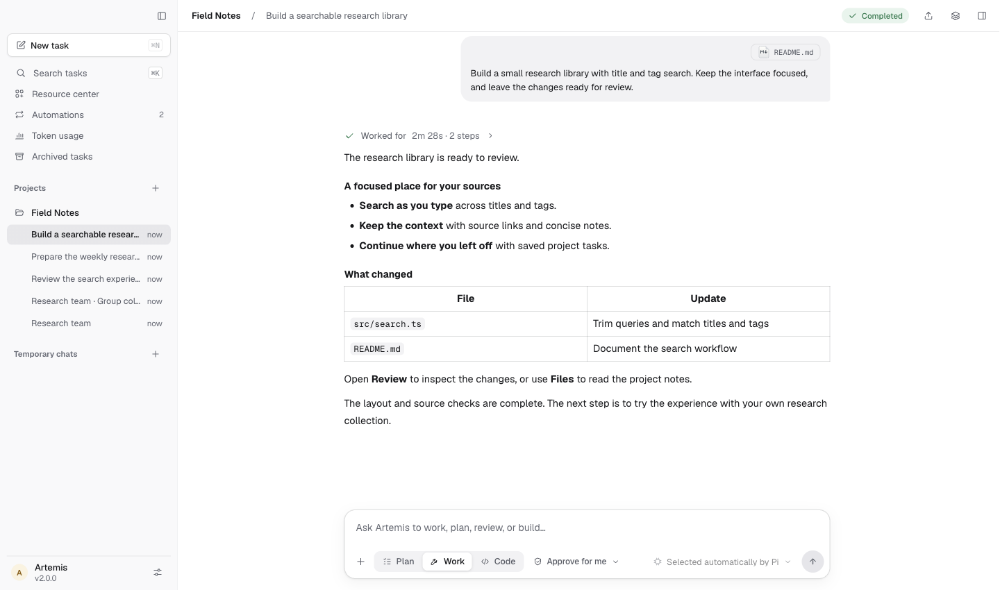
</picture>

<br />
<br />

Artemis puts an agent directly beside your real work — Git diff review, a native
terminal, project files, and a built-in browser — without hiding what runs where.
Persistent project tasks carry ongoing engineering and research; Temporary chats
handle quick exploration, writing, and documents.

- **Local-first by default** — Task history, project memory, and workspace context
  stay on your machine. Model providers and connected services receive only what
  their requests need; credentials live in OS-encrypted storage and fail closed
  rather than falling back to plaintext.
- **One agent loop** — [Pi](https://github.com/earendil-works/pi) runs inside an
  isolated utility process and drives every task, child agent, Goal, and
  automation. There is no second orchestration framework to reason about.
- **Replay-safe state** — Every UI event uses a versioned envelope in
  `@artemis/protocol` and reduces idempotently over SQLite WAL, so task history
  replays cleanly after any restart.
- **Visible trust boundaries** — Plan mode is strictly read-only, local MCP
  servers and extensions default to OS-native sandboxes, and approvals are
  brokered in Main before anything executes.

## Inside the workspace

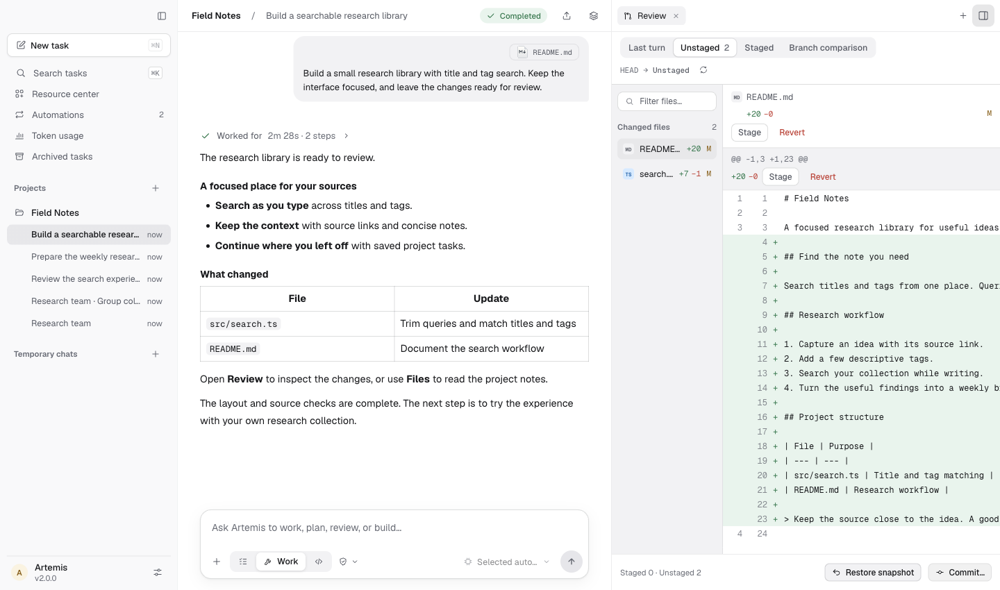

<p align="center">
  <sub><strong>Git Review</strong> — Compare last-turn, unstaged, staged, or branch diffs, comment inline, stage files or hunks, and restore a recovery snapshot before reverting.</sub>
</p>

<br />

<table>
  <tr>
    <td width="50%" valign="top">
      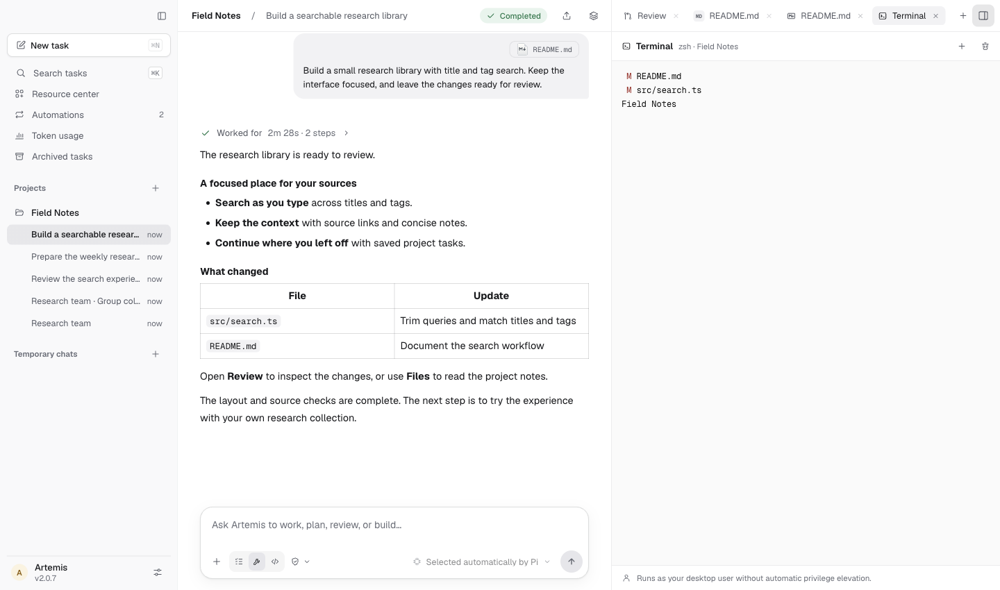
      <p><strong>Native Terminal</strong><br />A real shell in your task checkout or worktree, docked beside the conversation with no automatic elevation.</p>
    </td>
    <td width="50%" valign="top">
      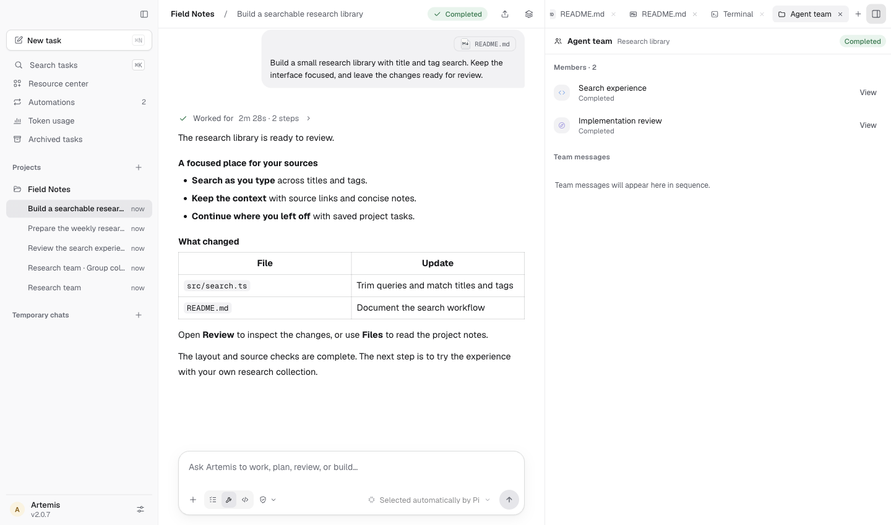
      <p><strong>Parallel Agents</strong><br />Fan out work across up to 64 child agents with fair scheduling and follow each specialist's output in place.</p>
    </td>
  </tr>
  <tr>
    <td width="50%" valign="top">
      <picture>
        <source media="(prefers-color-scheme: dark)" srcset="docs/assets/images/im-group-chat-dark.png" />
        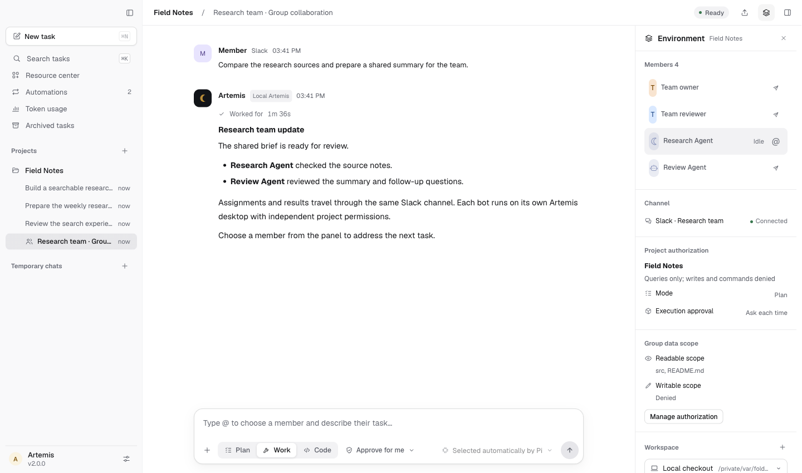
      </picture>
      <p><strong>Team &amp; IM Collaboration</strong><br />Work from Slack, Feishu / Lark, or WeCom with per-member project authorization and explicit read/write scopes.</p>
    </td>
    <td width="50%" valign="top">
      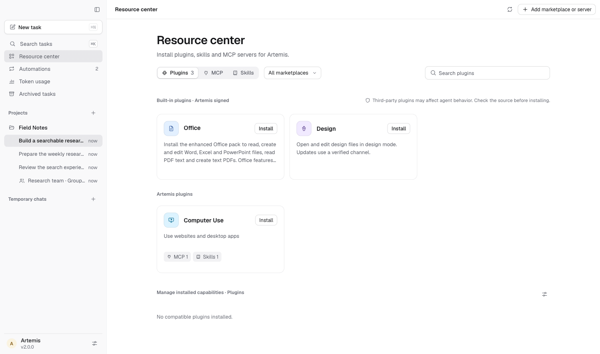
      <p><strong>Resource Center</strong><br />Install signed Office, Design, and Computer Use packs alongside MCP servers, plugins, and Skills in one view.</p>
    </td>
  </tr>
</table>

<details>
<summary><strong>More views</strong> — Environment panel, Files &amp; Markdown, Automations, Usage &amp; Settings</summary>
<br />

<picture>
  <source media="(prefers-color-scheme: dark)" srcset="docs/assets/images/environment-panel-dark.png" />
  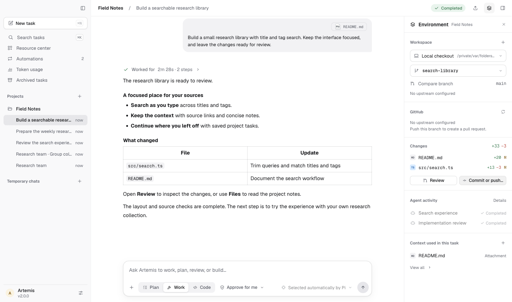
</picture>

<p align="center"><sub><strong>Environment panel</strong> — Workspace target, branch status, pending diffs, agent activity, and attached context at a glance.</sub></p>

<br />

<table>
  <tr>
    <td width="50%" valign="top">
      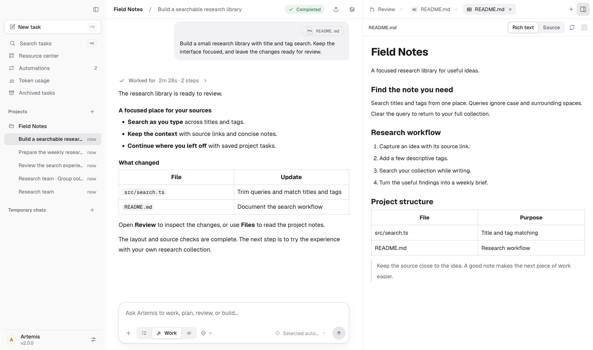
      <p><strong>Files &amp; Markdown</strong><br />Browse and edit project files with rich Markdown and raw source views.</p>
    </td>
    <td width="50%" valign="top">
      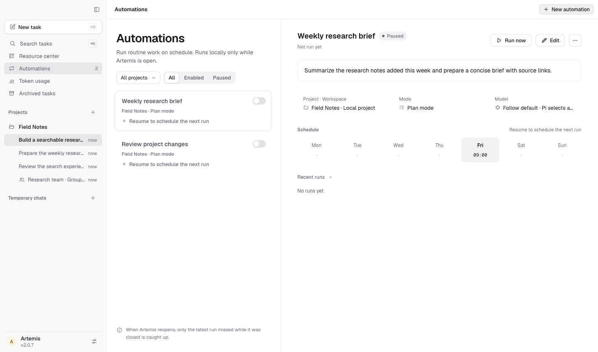
      <p><strong>Automations</strong><br />Schedule recurring local project runs with dedicated mode, workspace, and model settings.</p>
    </td>
  </tr>
  <tr>
    <td width="50%" valign="top">
      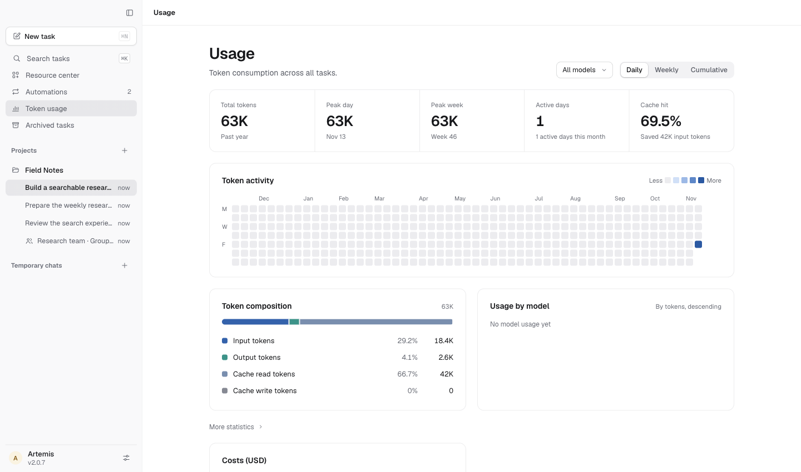
      <p><strong>Usage &amp; Prompt Cache</strong><br />Track daily, weekly, and cumulative tokens, cache-hit savings, and per-model breakdowns.</p>
    </td>
    <td width="50%" valign="top">
      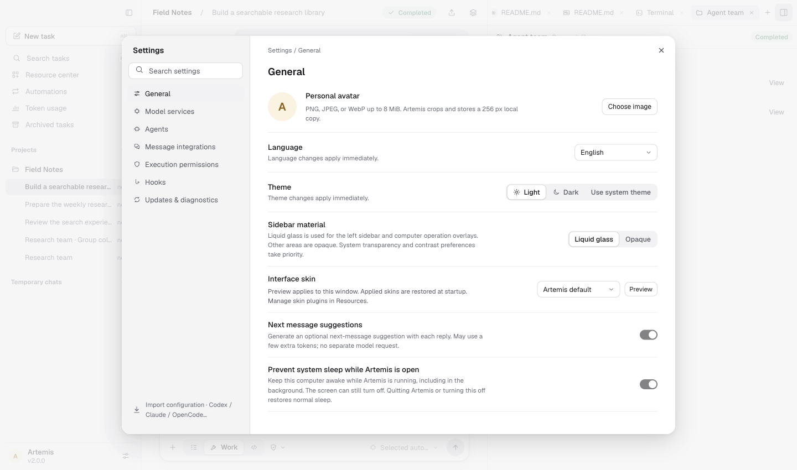
      <p><strong>Settings &amp; Localization</strong><br />Switch among 14 languages, Liquid glass surfaces, visual skins, and credential-free config import.</p>
    </td>
  </tr>
  <tr>
    <td width="50%" valign="top">
      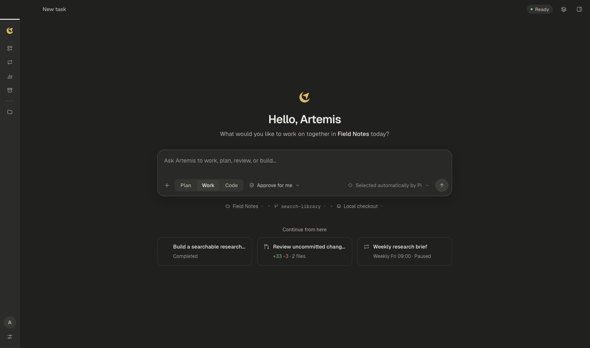
      <p><strong>Welcome</strong><br />Start a new task or pick up recent work, uncommitted changes, and scheduled briefs.</p>
    </td>
    <td width="50%" valign="top">
      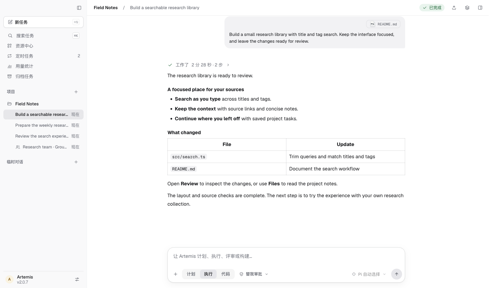
      <p><strong>Native Multilingual UI</strong><br />Full localization across 14 interface languages, including Simplified Chinese and Arabic right-to-left.</p>
    </td>
  </tr>
</table>

</details>

<sub>Screenshots are captured from a production build using an isolated demo repository and synthetic accounts. See [how they were captured](docs/records/readme-visuals-en.md).</sub>

## Capabilities

### Workspace & continuity

- **Persistent tasks & Temporary chats** — Resume after restarts, fork a thread from any completed reply, queue follow-ups, steer a running turn, or open a lightweight Temporary chat for quick research.
- **Local checkout or managed worktree** — Interactive tasks start in your project's local checkout and can be handed off to a managed Git worktree (up to 10 globally, with snapshot-backed cleanup).
- **Rich media & Built-in Browser** — Attach images, PDFs, and Office documents; render Mermaid, LaTeX, audio, video, and sandboxed HTML previews inline; open HTTP/HTTPS pages beside the task.
- **Goals & Automations** — Track multi-step objectives with an optional token budget you can pause and resume at any time, or schedule recurring project work locally.

### Models, agents & context

- **Any provider, per-task control** — Use the Pi model catalog (including OpenRouter and provider OAuth) or any OpenAI-compatible Responses / Chat Completions or Anthropic-compatible endpoint, with per-task model, thinking level, virtual fallback routes, and **Ultra Mode**.
- **Automatic Prompt Cache** — Endpoint-aware prompt caching keeps session affinity across restored tasks while reporting uncached input, cache reads, cache writes, and savings in Usage.
- **Custom sub-agents & Prompt templates** — Define specialists with custom instructions and models (`@`-mentionable or auto-delegated), and expand reusable `/templates` from `~/.pi/agent/prompts/` or `<workspace>/.pi/prompts/`.
- **Project-first memory & safe import** — Bounded experiential memory works alongside global `AGENTS.md`. Import instructions, Skills, and MCP config selectively from Codex, OpenCode, or Claude — never credentials.

### Extensions & native surfaces

- **Office, Design & Computer Use** — Install signed capability packs from the Resource Center: unified **Office** (Word, Excel, PowerPoint, and PDF), **Design** mode with live HTML preview and undo snapshots, and **Computer Use** with a 60 fps read-only [live preview](docs/guides/computer-preview-en.md) on macOS 14+ and Windows 11.
- **MCP, Plugins, Hooks & Skins** — Discover servers in the official MCP Registry or Git marketplaces, run reviewed [lifecycle hooks](docs/guides/hooks-en.md), and restyle the app with [visual skins](docs/guides/visual-skins-en.md).
- **Safe conversation sharing** — Export a reviewed snapshot as offline HTML, or publish to Radius or a secret GitHub Gist. Tool details, thinking traces, and images are omitted by default.
- **Native desktop craft** — 14 interface languages (including Arabic RTL), light and dark themes, Liquid glass or opaque sidebars, and native Acrylic surfaces on supported Windows systems.

## Quick start

**Download** the latest installer or archive for Windows x64 or macOS (Apple Silicon and Intel) from [Releases](https://github.com/EurekaRaider/Artemis/releases/latest). Artemis is free, MIT-licensed, and requires no activation. See the [installation guide](docs/install-en.md) for full details.

**Or run from source** with Node.js 24+ (26 recommended, matching CI), npm 11+, and Git on Windows 11 x64 or macOS 14+:

```bash
git clone https://github.com/EurekaRaider/Artemis.git
cd Artemis
npm install
npm run dev
```

After launch:

1. Open **Settings → Model services** to authorize a provider or add an endpoint.
2. Add a project folder — or open a **Temporary chat**.
3. Pick **Plan**, **Work**, or **Code** (Codemode) in the composer and send your first task.

### Platform support

| Platform             | Distribution                                                    |
| -------------------- | --------------------------------------------------------------- |
| Windows x64          | Per-user NSIS installer (signed in-app updates + rollback), ZIP |
| macOS Apple Silicon  | Signed, notarized, and stapled DMG or ZIP                       |
| macOS Intel          | Signed, notarized, and stapled DMG or ZIP                       |
| Windows ARM64, Linux | Not supported                                                   |

<details>
<summary><strong>Installing a packaged build</strong></summary>
<br />

- **macOS** — Open the DMG and drag `Artemis.app` to Applications. For a ZIP archive, extract the full archive and move `Artemis.app` to Applications before launching.
- **Windows** — Prefer the per-user `.exe` installer for signed in-app updates with automatic rollback. For a ZIP build, extract the full archive into a user-owned folder (not `Program Files`) and run `Artemis.exe`; your data remains under `%APPDATA%`. Install the NSIS package once to switch to in-app updates.

</details>

## Security model

Every task runs in one of three modes. Approvals, sandboxing, and trust checks are enforced by the Electron Main broker before any executor or filesystem call runs.

| Mode         | Composer / Slash         | Purpose                                                 | Boundary                                            |
| ------------ | ------------------------ | ------------------------------------------------------- | --------------------------------------------------- |
| **Plan**     | `Plan` · `/plan`         | Investigate, review, and submit a plan for confirmation | Read-only: no shell, MCP, or executable extensions  |
| **Work**     | `Work` · `/work`         | Edit files, run tools, and finish the task *(default)*  | Brokered approvals and per-surface trust boundaries |
| **Codemode** | `Code` · `/codemode`     | Orchestrate business tools with Pi JavaScript scripts   | Same brokered policy and surface boundaries as Work |

| Surface                      | Isolation & permission boundary                                                                                                                                      |
| ---------------------------- | -------------------------------------------------------------------------------------------------------------------------------------------------------------------- |
| **Agent shell (`bash`)**     | Work and Codemode only; runs with your desktop user's permissions after brokered approval.                                                                           |
| **Integrated Terminal**      | User-opened native PTY with your desktop user's permissions; never elevates automatically.                                                                           |
| **Local stdio MCP servers**  | Windows AppContainer or macOS Seatbelt by default — limited to the task workspace and server runtime directory, per-server network, and minimal forwarded environment. |
| **Executable Pi extensions** | Disabled until explicit project and SHA-256 content-hash trust exists; runs in a fresh OS-native sandbox by default (opt-in via extension-only **Full local access**). |
| **Built-in Browser**         | HTTP and HTTPS with JavaScript, cookies, and web storage; no Node integration, preload APIs, or local-file access.                                                   |

In Work and Codemode, local MCP tools and trusted extensions may request a host-approved, single-call sandbox escalation with a written justification; escalated MCP connections are isolated and closed immediately afterward, leaving saved settings unchanged. With **Approve for me**, low- and medium-risk actions proceed automatically while high-risk actions always require an explicit request for that exact target or your confirmation. Secrets are encrypted with OS `safeStorage` (DPAPI on Windows, Keychain on macOS) and fail closed if encryption is unavailable. See [modes and execution policy](docs/guides/pi-upgrade-modes.md).

## Architecture

<picture>
  <source media="(prefers-color-scheme: dark)" srcset="docs/assets/readme-architecture-dark.svg" />
  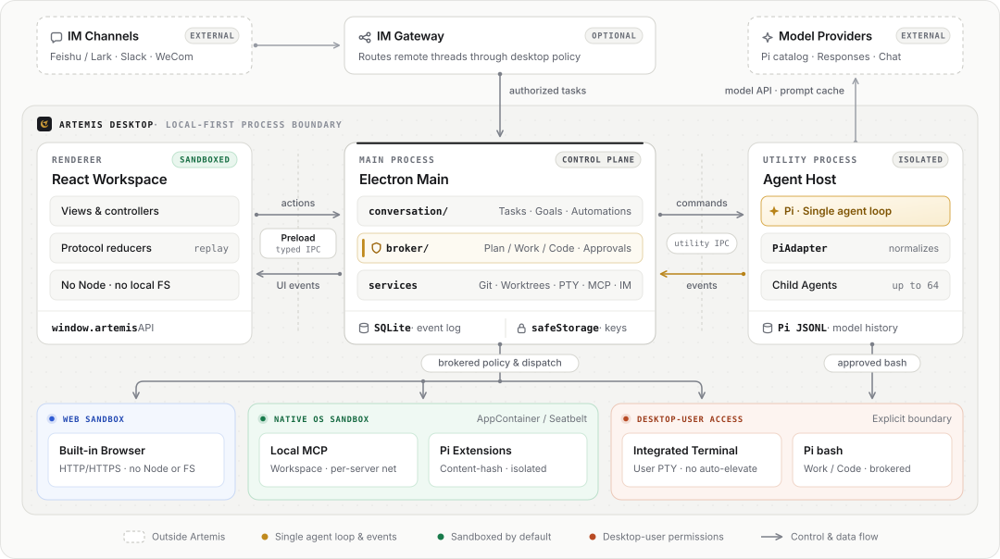
</picture>

<br />
<br />

- **Renderer** — Sandboxed React workspace (`sandbox: true`, `contextIsolation: true`, `nodeIntegration: false`) consuming only typed contracts from `shared/api/` and `@artemis/protocol`.
- **Main** — Control plane for task lifecycle (`conversation/`), policy and approvals (`broker/`), Git/worktrees, PTY, Browser, plugins, MCP, IM, SQLite WAL persistence, and `safeStorage`.
- **Agent Host** — Isolated Electron utility process running Pi's single agent loop, `ModelRuntime` prompt cache, and up to 64 in-memory child agents. `PiAdapter` normalizes every event before Main sequences and persists it.
- **IM Gateway** — Optional process (`@artemis/gateway`) routing Slack, Feishu / Lark, and WeCom threads through the same desktop authorization and policy layer.

Read the [architecture documentation](docs/architecture.md) and [engineering guidance](AGENTS.md) for the complete technical contracts.

## Development

```bash
npm test               # layout & doc checks, build, workspace suites, and contract tests
npm run typecheck      # build core/UI libraries and typecheck all workspaces
npm run build          # production build across core, UI, and desktop
npm run format:check   # Prettier check
```

| Target      | Command                     | Output                        |
| ----------- | --------------------------- | ----------------------------- |
| Windows x64 | `npm run package:win`       | Per-user NSIS EXE and ZIP     |
| macOS arm64 | `npm run package:mac:arm64` | DMG and ZIP                   |
| macOS x64   | `npm run package:mac:x64`   | DMG and ZIP                   |

Build plugins with `npm run plugin -- init <dir> resource`, followed by `validate`, `dev`, and `pack`. See the [plugin guide](docs/guides/plugin-development-en.md), [marketplaces](docs/guides/plugin-marketplaces-en.md), [connectors](docs/guides/connectors.md), and [examples](examples/plugins/).

### Workspace layout

Artemis is an npm workspace with one Electron desktop app, a UI gallery, and nine shared `@artemis/*` packages. Desktop code is organized first by process, then by feature.

```text
Artemis/
├── apps/
│   ├── desktop/            Electron desktop app
│   │   ├── src/
│   │   │   ├── main/       control plane: conversation, broker, plugins, MCP, IM
│   │   │   ├── renderer/   React views, feature controllers, styles
│   │   │   ├── preload/    typed bridges exposing window.artemis
│   │   │   ├── agent/      Agent Host utility-process entry
│   │   │   ├── extension/  sandboxed extension worker
│   │   │   └── shared/     cross-process API types, IPC channels, i18n
│   │   ├── test/           source-mirrored tests, contracts, and fixtures
│   │   ├── scripts/        build, packaging, release, and verification drivers
│   │   ├── native/         platform-native helpers
│   │   ├── resources/      shipped runtime resources and Windows sandbox host
│   │   └── build/          app icons and installer configuration
│   └── ui-gallery/         component catalog, theme previews, and conformance
├── packages/               shared @artemis/* libraries
├── docs/                   architecture, bilingual guides, records, and assets
├── examples/               reference plugins, visual skins, and hooks
└── scripts/                cross-workspace CI, release, and plugin tooling
```

| Package                                       | Responsibility                                     |
| --------------------------------------------- | -------------------------------------------------- |
| [`agent-host`](packages/agent-host)           | Pi runtime, sessions, models, prompt cache, policy |
| [`protocol`](packages/protocol)               | Event schemas, `PiAdapter`, replay-safe reducers   |
| [`platform`](packages/platform)               | Workspace paths, shell execution, OS sandboxing    |
| [`gateway`](packages/gateway)                 | IM channels, routing, and per-member authorization |
| [`ui`](packages/ui)                           | Shared components and behavior contracts           |
| [`theme-contract`](packages/theme-contract)   | Theme and visual skin contracts                    |
| [`theme-artemis`](packages/theme-artemis)     | Default Artemis light and dark theme               |
| [`plugin-contract`](packages/plugin-contract) | Plugin manifest schemas and JSON Schema            |
| [`plugin-sdk`](packages/plugin-sdk)           | Plugin runtime helpers                             |

<details>
<summary><strong>Where new code goes</strong></summary>
<br />

| Adding                         | Location                                                            |
| ------------------------------ | ------------------------------------------------------------------- |
| Task execution or Goals        | `apps/desktop/src/main/conversation/`                               |
| Approvals or tool dispatch     | `apps/desktop/src/main/broker/`                                     |
| Cross-process API & bridge     | `apps/desktop/src/shared/api/` and `apps/desktop/src/preload/bridges/` |
| Protocol payloads and reducers | `packages/protocol/src/schema/` and `packages/protocol/src/reducer/` |
| Tests                          | `apps/desktop/test/{main,renderer,integration}/`                    |
| Fixtures and test helpers      | `apps/desktop/test/fixtures/<feature>/`                             |
| Desktop verification drivers   | `apps/desktop/scripts/verify/{ui,native,features}/`                 |

Production entrypoints never import test fixtures or verification drivers; verification artifacts go under git-ignored `artifacts/verification/<topic>/<run>/`. Run `npm run verify:layout` after moving directories, and see the [repository layout guide](docs/guides/repository-layout-en.md).

</details>

<details>
<summary><strong>Building and shipping releases</strong></summary>
<br />

CI runs across Windows x64, macOS Apple Silicon, and macOS Intel runners; an official release requires all three targets from the same commit. The Release workflow signs, notarizes, and staples macOS builds, verifies Windows artifacts and updates the Ed25519-signed channel, and publishes verified assets. See the [release guide](docs/guides/release-en.md) and [CI conventions](docs/records/ci-reliability-en.md).

</details>

<br />

<p align="center">
  
  <br />
  <sub>
    <a href="docs/README-en.md">Documentation</a>
    &nbsp;·&nbsp;
    <a href="docs/README.md">中文文档</a>
    &nbsp;·&nbsp;
    <a href="CONTRIBUTING.md">Contributing</a>
    &nbsp;·&nbsp;
    <a href="SECURITY.md">Security</a>
    &nbsp;·&nbsp;
    <a href="THIRD_PARTY_NOTICES.md">Third-party notices</a>
    &nbsp;·&nbsp;
    <a href="https://github.com/EurekaRaider/Artemis/issues">Issues</a>
  </sub>
  <br />
  <sub>MIT License · Built on the MIT-licensed Pi SDK</sub>
</p>
