<p align="center">
  
</p>

<h1 align="center">Artemis</h1>

<p align="center">
  A local-first desktop agent for coding, research and everyday work.
</p>

<p align="center">
  <a href="#platform-support"><picture><source media="(prefers-color-scheme: dark)" srcset="docs/assets/readme-meta-windows-dark.svg" /></picture></a>
  &nbsp;
  <a href="#platform-support"><picture><source media="(prefers-color-scheme: dark)" srcset="docs/assets/readme-meta-macos-dark.svg" /></picture></a>
  &nbsp;
  <a href="LICENSE"><picture><source media="(prefers-color-scheme: dark)" srcset="docs/assets/readme-meta-license-dark.svg" /></picture></a>
</p>

<p align="center">
  <a href="https://github.com/EurekaRaider/Artemis/releases/latest"><strong>Download</strong></a>
  &nbsp;·&nbsp;
  <a href="#quick-start"><strong>Quick start</strong></a>
  &nbsp;·&nbsp;
  <a href="#a-quick-tour"><strong>Tour</strong></a>
  &nbsp;·&nbsp;
  <a href="docs/README-en.md"><strong>Documentation</strong></a>
</p>

<br />

<picture>
  <source media="(prefers-color-scheme: dark)" srcset="docs/assets/images/workspace-dark.png" />
  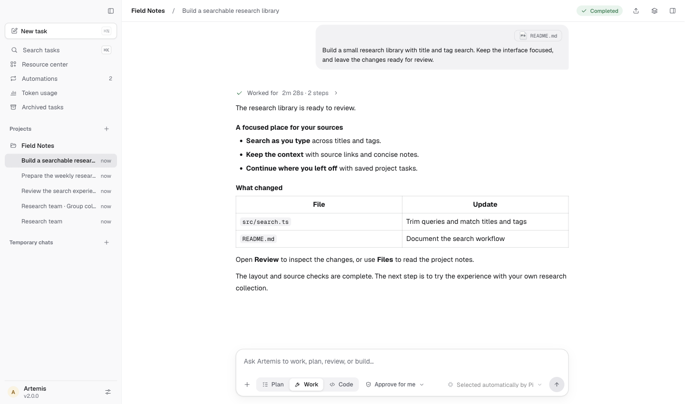
</picture>

<br />
<br />

Artemis is a desktop workspace where an agent works with your real files,
repositories and tools — a terminal, a browser, Git review — inside boundaries
you can see. Persistent project tasks carry ongoing work; Temporary chats handle
quick research, documents, spreadsheets and presentations.

<table>
  <tr>
    <td width="50%" valign="top">
      <h4>Local-first</h4>
      Project history, memory and context stay on your computer. Model providers
      and connected services receive the data their requests need, and
      credentials are protected by operating-system encryption.
    </td>
    <td width="50%" valign="top">
      <h4>Replay-safe</h4>
      Every persisted event is versioned and reduced idempotently, so task
      history replays cleanly after a restart.
    </td>
  </tr>
  <tr>
    <td width="50%" valign="top">
      <h4>Explicit trust</h4>
      Plan mode is read-only, local MCP servers run in a native sandbox, and
      extensions and hooks stay disabled until you trust their exact content.
    </td>
    <td width="50%" valign="top">
      <h4>One agent loop</h4>
      <a href="https://github.com/earendil-works/pi">Pi</a> drives every task,
      child Agent and automation — no second orchestration layer to reason about.
    </td>
  </tr>
</table>

## A quick tour

<table>
  <tr>
    <td width="50%" valign="top">
      <a href="docs/assets/images/git-review.png">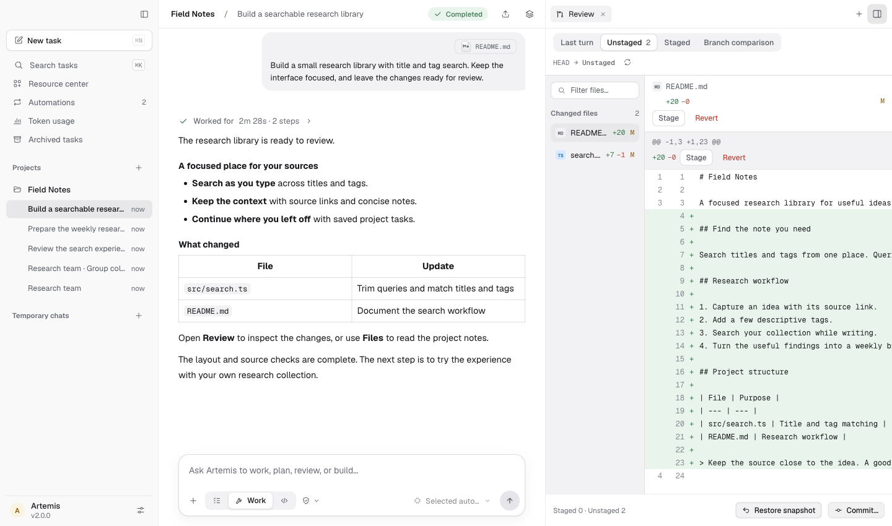</a>
      <p><strong>Git Review</strong><br />Compare turn, staged or branch changes, comment inline, and stage files or hunks.</p>
    </td>
    <td width="50%" valign="top">
      <a href="docs/assets/images/terminal.png">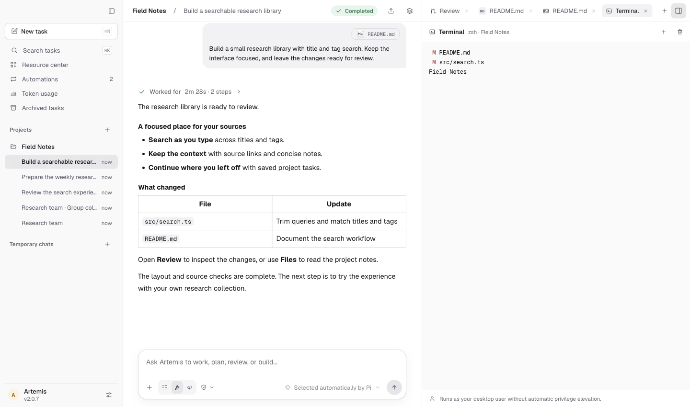</a>
      <p><strong>Native Terminal</strong><br />A real shell in the task workspace, docked beside the conversation.</p>
    </td>
  </tr>
  <tr>
    <td width="50%" valign="top">
      <a href="docs/assets/images/agent-team.png">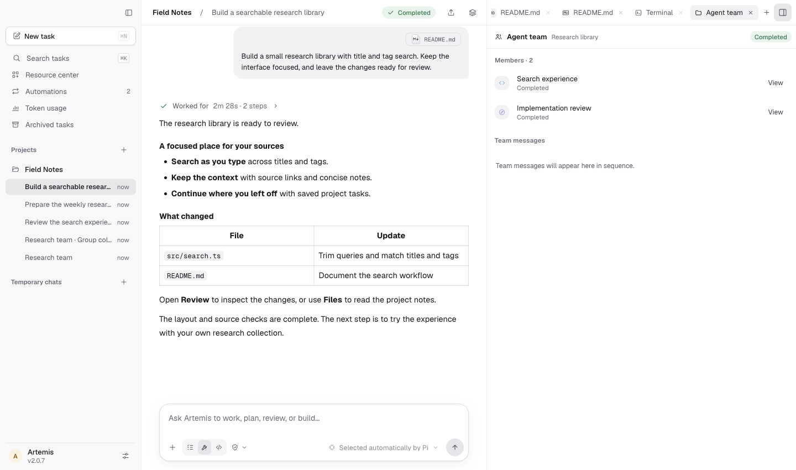</a>
      <p><strong>Parallel Agents</strong><br />Split work across up to 64 child Agents and follow each one's result.</p>
    </td>
    <td width="50%" valign="top">
      <a href="docs/assets/images/im-group-chat.png">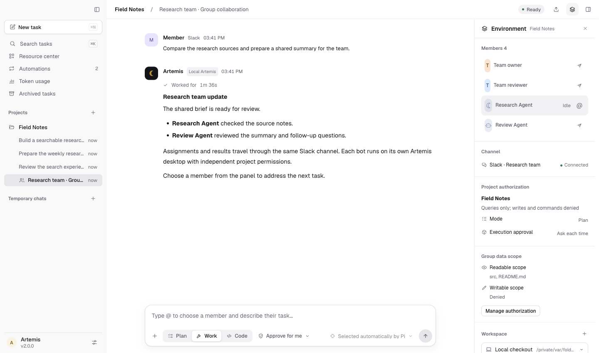</a>
      <p><strong>Group collaboration</strong><br />Work from Slack or Feishu / Lark with per-member project permissions.</p>
    </td>
  </tr>
  <tr>
    <td width="50%" valign="top">
      <a href="docs/assets/images/resources.png">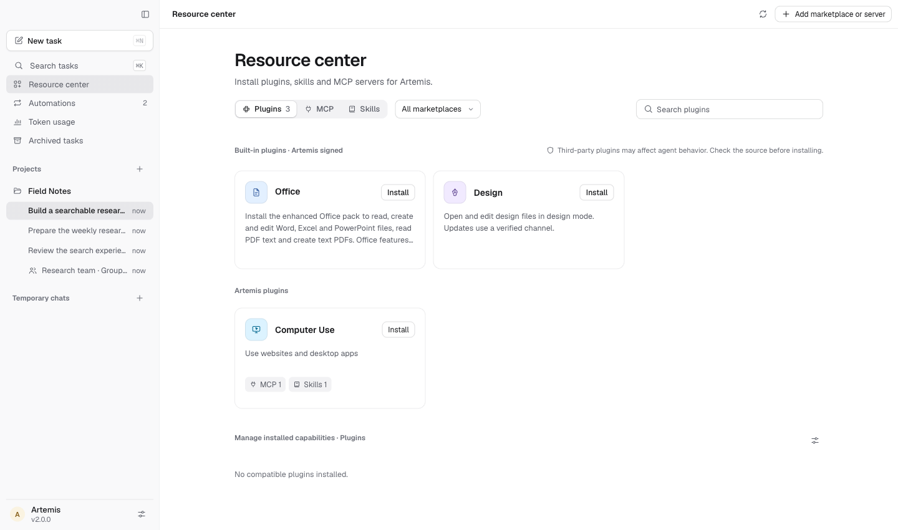</a>
      <p><strong>Resource Center</strong><br />Plugins, MCP servers and Skills, installed and managed in one place.</p>
    </td>
    <td width="50%" valign="top">
      <a href="docs/assets/images/markdown-files.png">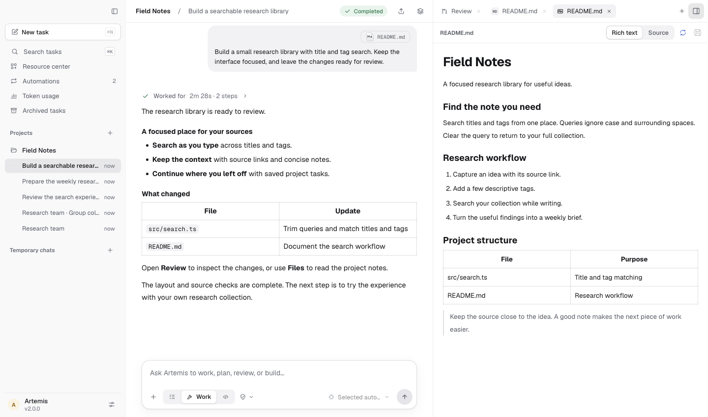</a>
      <p><strong>Files &amp; Markdown</strong><br />Read and edit project files with rich Markdown and source views.</p>
    </td>
  </tr>
  <tr>
    <td width="50%" valign="top">
      <a href="docs/assets/images/automations.png">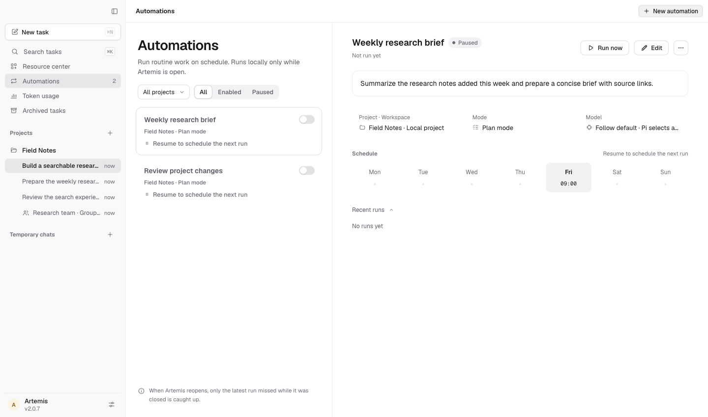</a>
      <p><strong>Automations</strong><br />Schedule recurring project work with its own model and reasoning settings.</p>
    </td>
    <td width="50%" valign="top">
      <a href="docs/assets/images/token-usage.png">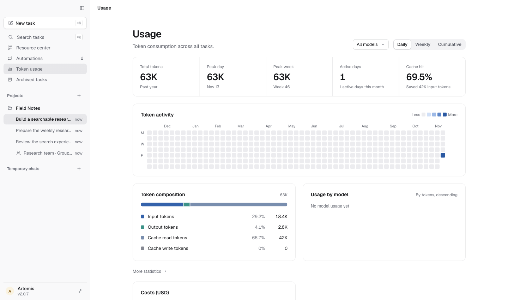</a>
      <p><strong>Usage insights</strong><br />Daily and cumulative Tokens, cache usage and per-model breakdowns.</p>
    </td>
  </tr>
</table>

<details>
<summary><strong>More screenshots</strong></summary>
<br />

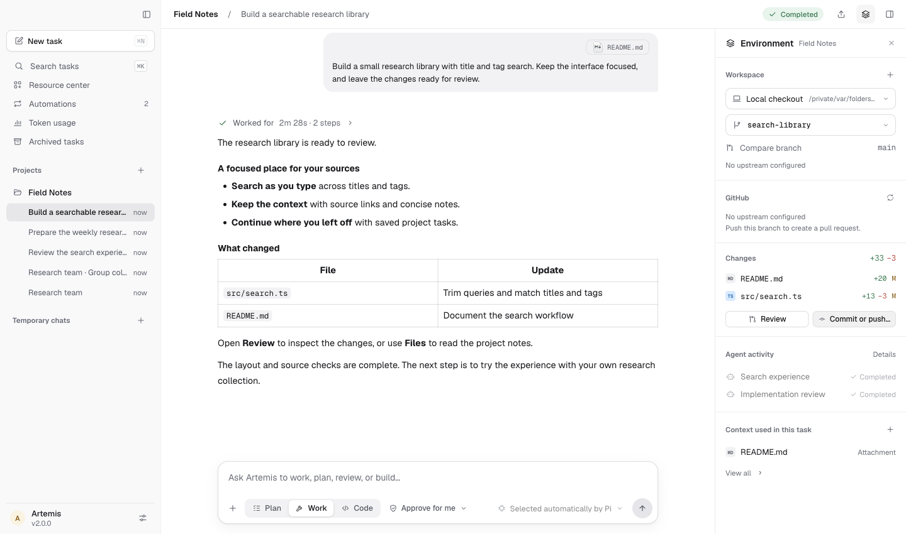

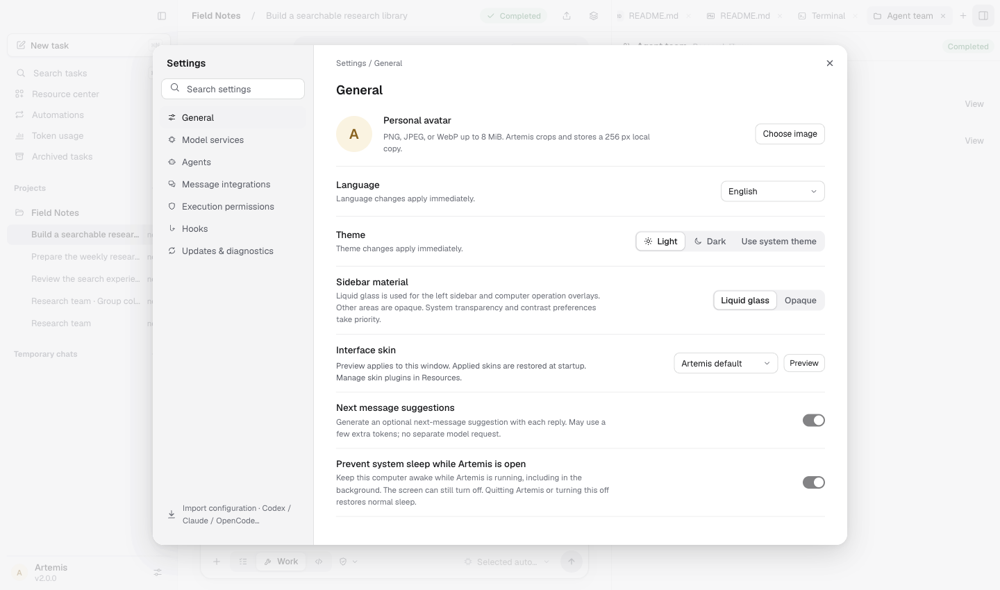

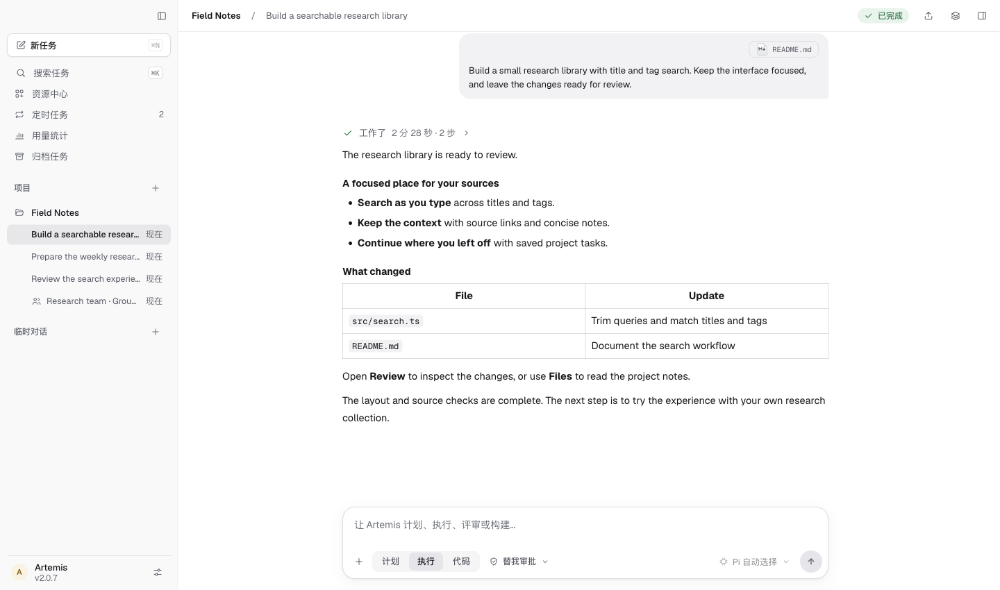

</details>

<sub>Screenshots use an isolated demo project and synthetic accounts. See
[how they were captured](docs/records/readme-visuals-en.md).</sub>

## Features

### Work on real projects

- **Persistent tasks** — resume after restart, fork a task, queue follow-ups,
  steer a running turn or cancel it.
- **Your checkout or a worktree** — tasks start in the project's local checkout
  and can be handed off to a managed Git worktree.
- **Rich conversation** — attach images, PDFs and Office files; see sources, tool
  activity and approvals inline; preview Mermaid, LaTeX, audio, video and
  sandboxed interactive HTML.
- **Built-in Browser** — open HTTP and HTTPS pages next to the task.

### Keep work moving

- **Goals** — track an objective with an optional Token budget; pause and resume
  it at any time.
- **Custom sub-agents** — give specialists their own instructions and model,
  then call them with `@` or let Artemis delegate.
- **Memory and instructions** — bounded, project-first memory plus global
  `AGENTS.md`. Import instructions, Skills and MCP settings from Codex, OpenCode
  or Claude — never credentials.
- **Share a conversation** — export a reviewed snapshot as offline HTML, or
  upload it to Radius or a secret GitHub Gist. Tool details, thinking and images
  are left out by default.

### Extend the workspace

- **Document tools** — bundled Documents, PDF, Spreadsheets and Presentations
  Lite plugins, with no external toolchain.
- **MCP and connected services** — discover servers in the official Registry or
  add them by hand; account authorization stays separate from configuration.
- **Computer Use** — let the agent operate websites and desktop apps through a
  signed native runtime on macOS 14+ and Windows 11.
- **Design mode** — edit workspace HTML with snapshots, undo and live preview.
- **Hooks and skins** — run reviewed [lifecycle hooks](docs/guides/hooks-en.md)
  and restyle the app with [visual skins](docs/guides/visual-skins-en.md).

### Choose your models

- **Any provider** — the Pi model catalog or any OpenAI-compatible Chat
  Completions or Responses endpoint.
- **Per-task settings** — each task keeps its own model, thinking level and
  context window.
- **Ultra Mode** — the model's highest thinking level and more parallel work,
  for hard problems.

### Feels at home

- 14 interface languages, including Arabic right-to-left.
- Light and dark themes with glass or solid surfaces.
- A unified title bar and native Acrylic surfaces on supported Windows systems.

## Quick start

**Download** the latest build for Windows x64 or macOS (Apple Silicon and Intel) from
[Releases](https://github.com/EurekaRaider/Artemis/releases/latest). Artemis is
free, MIT-licensed and needs no activation. See the
[installation guide](docs/install-en.md) for details.

**Or run from source** with Node.js 26, npm 11+ and Git on Windows 11 x64 or
macOS 14+ (Apple Silicon):

```bash
git clone https://github.com/EurekaRaider/Artemis.git
cd Artemis
npm install
npm run dev
```

Then:

1. Open **Settings → Providers & models** and pick a model.
2. Add a project folder, or start a **Temporary chat**.
3. Choose **Plan**, **Work** or **Codemode** and send your first task.

### Platform support

| Platform             | Distribution                                   |
| -------------------- | ---------------------------------------------- |
| Windows x64          | Per-user installer with in-app updates, or ZIP |
| macOS Apple Silicon  | Signed and notarized DMG or ZIP                |
| macOS Intel          | Signed and notarized DMG or ZIP                |
| Windows ARM64, Linux | Not supported                                  |

<details>
<summary><strong>Installing a packaged build</strong></summary>
<br />

**macOS** — open the DMG and drag `Artemis.app` to Applications. For a ZIP,
extract it and move `Artemis.app` to Applications before launching.

**Windows ZIP** — extract the whole archive into a folder you own (not
`Program Files`) and run `Artemis.exe`. ZIP builds update manually: extract the
new version into a new folder and keep your data under `%APPDATA%`. Install the
NSIS package once to switch to in-app updates.

</details>

## Security model

Every task runs in one of three modes. Approvals, sandboxing and trust checks
apply in all of them.

| Mode         | Use it to                                                    | Boundary                                         |
| ------------ | ------------------------------------------------------------ | ------------------------------------------------ |
| **Plan**     | Investigate, review and propose a plan for your confirmation | Read-only: no shell, MCP or executable extensions |
| **Work**     | Edit files, run tools and finish the task (default)          | Brokered approvals and per-surface permissions   |
| **Codemode** | Orchestrate tools with Pi scripts                            | Same as Work                                     |

| Surface                 | Runs with                                                                                                |
| ----------------------- | -------------------------------------------------------------------------------------------------------- |
| **Agent shell**         | Your desktop user's permissions, after brokered approval (Work and Codemode only)                       |
| **Integrated Terminal** | Your desktop user's permissions; never elevates automatically                                            |
| **Local MCP servers**   | AppContainer on Windows or Seatbelt on macOS by default, limited to the workspace with per-server network access |
| **Pi extensions**       | The native sandbox by default, and only after project and content-hash trust                             |
| **Browser**             | HTTP and HTTPS only; no Node, preload APIs or local files                                                |

With **Approve for me**, low- and medium-risk operations proceed automatically;
high-risk operations need an explicit request for that exact action or your
approval. Secrets are stored with operating-system encryption, and writes fail
rather than fall back to plain text. See
[modes in detail](docs/guides/pi-upgrade-modes.md).

## Architecture

<picture>
  <source media="(prefers-color-scheme: dark)" srcset="docs/assets/readme-architecture-dark.svg" />
  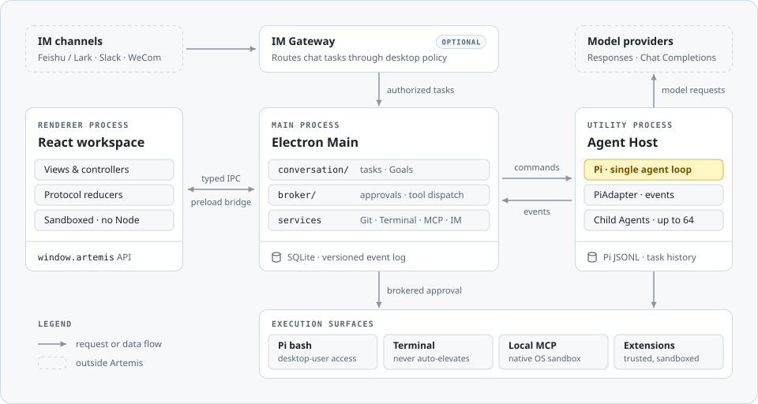
</picture>

- **Renderer** — React views with no Node or Electron access; they consume only
  typed contracts from `shared/api/` and `@artemis/protocol`.
- **Main** — owns task execution, approvals and tool dispatch, plus Git,
  Terminal, Browser, plugins, MCP, IM and automations.
- **Agent Host** — runs Pi in a utility process. `PiAdapter` normalizes its
  events; Main sequences and persists them for replay.
- **IM Gateway** — optional; routes remote conversations through the same
  authorization and execution policy.

Read the [architecture notes](docs/architecture.md) and
[engineering guidance](AGENTS.md) for the full picture.

## Repository layout

Artemis is an npm workspace: one desktop app, a set of shared packages, and the
docs, examples and tooling around them. Desktop code is grouped first by process,
then by feature.

```text
Artemis/
├── apps/
│   ├── desktop/                  Electron desktop app
│   │   ├── src/
│   │   │   ├── main/             host process: conversation, broker, plugins, MCP, IM …
│   │   │   ├── renderer/         React views, feature controllers and styles
│   │   │   ├── preload/          typed bridges that expose window.artemis
│   │   │   ├── agent/            Agent Host utility-process entry
│   │   │   ├── extension/        executable extension worker
│   │   │   └── shared/           cross-process API types, IPC channels and i18n
│   │   ├── test/                 tests that mirror src, plus contracts and fixtures
│   │   ├── scripts/              build, packaging, release and verification
│   │   ├── native/               platform-native helpers
│   │   ├── resources/            shipped runtime resources and sandbox hosts
│   │   └── build/                icons and installer configuration
│   └── ui-gallery/               component demos, themes and conformance
├── packages/                     shared libraries, listed below
├── docs/                         architecture, guides, records and visual assets
├── examples/                     plugins, visual skins and hooks
├── scripts/                      cross-workspace CI, release and tooling
├── vendor/                       vendored dependencies
├── third-party/                  third-party license texts
└── artifacts/                    git-ignored caches and verification output
```

### Shared packages

Each package is named `@artemis/<name>`.

| Package                                         | Owns                                                |
| ----------------------------------------------- | --------------------------------------------------- |
| [`agent-host`](packages/agent-host)             | Pi runtime, sessions, models, tools and policy      |
| [`protocol`](packages/protocol)                 | Event schemas, `PiAdapter` and replay-safe reducers |
| [`platform`](packages/platform)                 | Workspace paths, shell execution and sandboxing     |
| [`gateway`](packages/gateway)                   | IM channels, routing and authorization              |
| [`ui`](packages/ui)                             | Shared components and behavior contracts            |
| [`theme-contract`](packages/theme-contract)     | Theme and skin contracts                            |
| [`theme-artemis`](packages/theme-artemis)       | The default theme                                   |
| [`plugin-contract`](packages/plugin-contract)   | Plugin metadata and JSON Schema                     |
| [`plugin-sdk`](packages/plugin-sdk)             | Plugin runtime helpers                              |

### Where new code goes

Short paths are relative to `apps/desktop/`.

| Adding                          | Put it in                                                   |
| ------------------------------- | ----------------------------------------------------------- |
| Task execution or Goals         | `apps/desktop/src/main/conversation/`                       |
| Approvals or tool dispatch      | `apps/desktop/src/main/broker/`                             |
| A cross-process API             | `src/shared/api/`, bridged in `src/preload/bridges/`        |
| Protocol payloads and reducers  | `packages/protocol/src/schema/` and `reducer/`              |
| Tests                           | `test/main/`, `test/renderer/` or `test/integration/`       |
| Fixtures and test helpers       | `test/fixtures/<feature>/`                                  |
| Desktop verification drivers    | `apps/desktop/scripts/verify/{ui,native,features}/`         |

Production entrypoints never import test fixtures or verification drivers, and
verification output goes to `artifacts/verification/<topic>/<run>/`. See the
[repository layout guide](docs/guides/repository-layout-en.md) for the full
ownership rules, and run `npm run verify:layout` after moving directories.

## Development

```bash
npm test               # build, run every workspace suite and contract check
npm run typecheck
npm run build
npm run format:check
```

| Target      | Command                     | Output                     |
| ----------- | --------------------------- | -------------------------- |
| Windows x64 | `npm run package:win`       | Per-user NSIS EXE and ZIP  |
| macOS arm64 | `npm run package:mac:arm64` | DMG and ZIP                |
| macOS x64   | `npm run package:mac:x64`   | DMG and ZIP                |

Build plugins with `npm run plugin -- init <dir> resource`, then `validate`,
`dev` and `pack`. Start with the [plugin guide](docs/guides/plugin-development-en.md),
[marketplaces](docs/guides/plugin-marketplaces-en.md),
[connectors](docs/guides/connectors.md) and [examples](examples/plugins/).

<details>
<summary><strong>Building and shipping releases</strong></summary>
<br />

CI runs on Windows, Apple Silicon and Intel macOS runners; a release needs all
three from the same commit. The Release workflow signs and notarizes macOS
builds, verifies the Windows artifacts and publishes them. See the
[release guide](docs/guides/release-en.md) and
[CI conventions](docs/records/ci-reliability-en.md).

</details>

<br />

<p align="center">
  
  <br />
  <sub>
    <a href="CONTRIBUTING.md">Contributing</a>
    &nbsp;·&nbsp;
    <a href="SECURITY.md">Security</a>
    &nbsp;·&nbsp;
    <a href="THIRD_PARTY_NOTICES.md">Third-party notices</a>
    &nbsp;·&nbsp;
    <a href="https://github.com/EurekaRaider/Artemis/issues">Feedback</a>
  </sub>
  <br />
  <sub>MIT License · Built on the MIT-licensed Pi SDK</sub>
</p>
